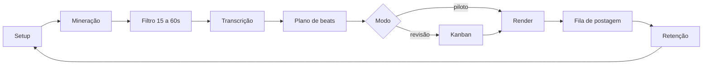

# VideoViral — Guia de desenvolvimento

Documento para seguir a partir da fase do estúdio de reação. O checklist do que já existe (mineração, corte, Kanban, render) continua em [PROJECT.md](PROJECT.md).

A diferenciação do vídeo é o comentário: avatar, roteiro, tela dividida, legendas e trilha. O pipeline não tem etapa para enganar detector de conteúdo reutilizado, nem para apagar marca d'água. Fonte com título de republicação (TikTok, Reels, repost) é descartada na mineração.

## Decisão de stack

O app continua um serviço Python local, aberto no navegador. FFmpeg, Whisper e o render já vivem nesse processo. Electron duplicaria o pipeline em Node. Streamlit aperta o preview de vídeo e a fila. Next.js só vale se o dashboard virar um produto separado.

Uma janela nativa, se fizer falta, entra depois com pywebview apontando para `http://127.0.0.1:8000`. Não muda o código do estúdio.

| Camada | Escolha agora | Por quê | Custo |
|---|---|---|---|
| App | FastAPI + HTML em `api/static` | Já roda o Kanban e o setup | Zero |
| Orquestração | `src/orchestrator/pipeline.py` | Um processo, um job, fácil de depurar | Zero |
| Fila futura | SQLite, depois Redis | JSON aguenta o MVP local | Zero até o worker |
| Vídeo | FFmpeg | Corte, 1080×1920, tela dividida, ASS | Zero |
| Transcrição | OpenAI Whisper já ligado; `faster-whisper` small como padrão local na fase seguinte | 60s de áudio cabe em CPU | API ~US$ 0,006/min, local grátis |
| Roteiro | Gemini Flash, com as falas de referência se a chave faltar | O dry-run não depende de crédito | Centavos por roteiro |
| Voz | Edge TTS como padrão; ElevenLabs quando a voz for o produto | Edge não cobra | ElevenLabs por caractere |
| Avatar | Placeholder local no dev; HeyGen com chave | Lip-sync local (SadTalker / LivePortrait) só com GPU | HeyGen por minuto |
| Mineração | YouTube Data API v3 + `yt-dlp` | Quota gratuita e download do arquivo que a busca devolveu | Quota diária |
| TikTok / Reels como fonte | Fora do caminho crítico | Não há API estável. Não usar sessão de navegador | — |
| Publicação | YouTube Data API (`videos.insert`) e Instagram Graph para conta profissional | Token OAuth da conta do usuário | Quota |
| TikTok publicação | Export do MP4 + legenda até a Content Posting API ser aprovada | Postar dirigindo um Chrome logado queima a conta | — |
| Métricas | YouTube Analytics (`averageViewPercentage`) + formulário manual no setup | O peso do próximo vídeo sai da retenção | Quota |
| Legendas | ASS palavra a palavra, estilo já em `src/subtitles.py` | Retenção, sem SaaS | Zero |

## Estrutura

```
videoviral/
├── DESENVOLVIMENTO.md          ← este guia
├── PROJECT.md                  ← checklist do MVP já em andamento
├── config/settings.py
├── src/
│   ├── miner.py                ← busca + velocidade (views/hora) + filtros
│   ├── source_filters.py       ← 15–60s, engajamento, título de republicação
│   ├── clipper.py              ← Whisper, corte, 9:16
│   ├── subtitles.py            ← ASS
│   ├── avatar_gen.py           ← roteiro curto legado, ElevenLabs, HeyGen
│   ├── renderer.py             ← duet 50/50 e PiP
│   ├── interaction/
│   │   ├── levels.py           ← catálogo dos níveis 1–5
│   │   └── planner.py          ← beats: ouvindo / falando
│   ├── studio/
│   │   ├── models.py           ← StudioConfig, Account, pesos
│   │   └── store.py            ← storage/studio/*.json (sem segredos)
│   ├── growth/engine.py        ← sobe o peso do que reteve
│   ├── orchestrator/pipeline.py
│   └── pipeline/               ← clip flow e render já existentes
├── api/
│   ├── main.py                 ← /  Kanban,  /setup  estúdio
│   ├── routes/setup.py
│   └── static/setup.html
└── storage/
    ├── raw/ clips/ output/ audio/ avatars/
    └── studio/                 ← config, contas, pesos (gitignored)
```

Segredos ficam no `.env` (YouTube, Gemini, OpenAI, ElevenLabs, HeyGen). A tela de contas guarda @, horário de pico e o estado `oauth_pending` / `oauth_ready` / `manual_export`. Não guarda senha nem cookie.

## Pipeline



Estágios do orquestrador, nesta ordem:

1. **config** — lê `storage/studio/config.json` (nicho, nível, tom, layout, modo, conta).
2. **screen** — na mineração: duração 15–60s, engajamento mínimo, views por hora, descarte de título que já aponta outra rede. Um arquivo passado em `--input` é cortado até 60s pelo clipper.
3. **transcribe** — áudio com FFmpeg e Whisper. No dry-run esta etapa é pulada.
4. **plan** — `build_plan()` devolve beats com `listening` ou `speaking`, e `pause_source` no nível 3 e 4.
5. **voice** — ainda não roda no dry-run. No render, o texto falado vira áudio e o avatar usa esse áudio.
6. **queue** — grava um `JobRecord`. Revisão para no Kanban. Piloto só segue se o sentimento não pedir humano e existir clipe.
7. **render** — `render_job.py` respeita o roteiro do plano e o layout `duet` ou `pip`.

O dry-run existe para ver o contrato ponta a ponta sem crédito de API:

```powershell
python -m src.orchestrator.pipeline --dry-run --level 3 --niche financas
```

Com vídeo local, o corte reusa o clipper e não aplica o módulo antigo de microalteração:

```powershell
python -m src.orchestrator.pipeline --input storage/raw/sample.mp4 --mock-transcribe
```

## Níveis de interação

| Nível | Nome | Avatar | Vídeo original |
|---|---|---|---|
| 1 | Reação rápida | Fala no início (~2,5s) e no fim (~3s) | Segue no meio, avatar ouvindo |
| 2 | Reação com um corte | Gancho, um comentário no meio, fecho | Segue |
| 3 | Comentário intercalado | Dois comentários além do gancho | Pausa enquanto o avatar fala |
| 4 | Debate | Duas refutações | Pausa em cada refutação |
| 5 | Análise profunda | Gancho preso nos 3 primeiros segundos, narração por cima, uma refutação, fecho | Não pausa; a voz entra por cima |

Cada beat é `{t_start, t_end, state, pause_source, line, purpose}`. `purpose` é `hook`, `reaction`, `rebuttal`, `narration`, `closer` ou `listen`. O texto falado concatenado vai para `reaction_script` e aparece no cartão do Kanban.

As falas de referência são locais, para a simulação funcionar sem Gemini. Quando a transcrição existir, o mesmo JSON de beats é o contrato. Trocar o texto por uma resposta do LLM não muda o render.

### Como o render deve usar o beat (próxima etapa de código)

- `speaking` + `pause_source=false`: o original continua; o avatar está em lip-sync. No nível 5 o gancho ocupa 0–3s.
- `listening`: avatar em pose de reação, boca parada, áudio do original em primeiro plano.
- `speaking` + `pause_source=true`: o original congela (último frame) e o áudio original abaixa enquanto a fala do avatar entra. É o comportamento do nível 3.

Legendas ASS no estilo palavra destacada continuam em `src/subtitles.py`, queimadas na composição. Trilha, quando `background_music` estiver ligado, entra a cerca de 8% (`music_volume`) por baixo da voz. Zoom leve no gancho é recurso de retenção do render, no mesmo filtro de escala que já existe — não é uma etapa separada de “originalidade”.

## Contas e horários

Modelo em `Account`: `platform`, `handle`, `label`, `enabled`, `peak_hours`, `auth`.

| Plataforma | Como publica | Estado inicial |
|---|---|---|
| YouTube | OAuth do dono do canal + `videos.insert`. Shorts = arquivo 9:16, até 60s, título e descrição no snippet | `oauth_pending` |
| Instagram | Graph API de conteúdo, conta profissional ligada a uma Página | `oauth_pending` |
| TikTok | MP4 e texto prontos na pasta de saída, postagem manual, até a API oficial | `manual_export` |

O agendador, quando for implementado, escolhe o próximo `peak_hours` da conta habilitada (hora local). Antes disso a fila só guarda `account_id` no metadata do job.

## Motor de retenção

Linha de base: **45%** de retenção média. `record_outcome()` multiplica o peso do nicho, do tom, do nível e do layout que rodaram:

`novo = clamp(peso * (1 + (retenção - 45) / 100), 0.25, 4)`

`suggest_next()` devolve a combinação com maior peso. O botão “Simular com maior peso” e a flag `--use-suggestion` aplicam isso no plano. Ainda não há coleta automática: o número entra no setup, ou no futuro via YouTube Analytics.

## Como testar agora

```powershell
python -m venv .venv
.venv\Scripts\activate
pip install -r requirements.txt
copy .env.example .env

python -m src.orchestrator.pipeline --dry-run --level 5

python run_api.py
# http://127.0.0.1:8000/setup
# http://127.0.0.1:8000
```

No setup: escolher nível, salvar, simular. O JSON dos beats aparece na tela e o job entra em Aguardando. Aprovar essa simulação responde 400, porque não há clipe. “Regerar tom” no Kanban reconstrói os beats daquele nível.

Critério desta etapa: dry-run imprime `stages` com `plan` e `queue` em `done`, e a tela de setup grava config, conta e um outcome de retenção sem reiniciar o processo.

## Publicar na VPS

O painel sobe com Docker. Caddy escuta nas portas 80 e 443 e encaminha para a API. A porta 8000 não fica aberta na internet. Com `DASHBOARD_PASSWORD` preenchido, o navegador pede usuário e senha. Sem domínio, a URL é `http://IP`. Com `VIDEOVIRAL_DOMAIN` no `.env` e o DNS apontando para a VPS, o Caddy pede o certificado.

Na VPS, dentro da pasta do projeto:

```bash
bash deploy/vps-up.sh
```

O script instala o Docker se faltar, gera a senha do painel se o `.env` estiver vazio e sobe `docker-compose.prod.yml`. Vídeos e a fila ficam no volume `videoviral-data`. Chaves de API ficam só no `.env` da VPS, fora da imagem.

Máquina mínima: 2 GB de RAM, Ubuntu, portas 22, 80 e 443 liberadas. FFmpeg já entra na imagem. Postgres, Redis e MinIO do `docker-compose.yml` antigo não sobem nesse caminho.

## Fases seguintes

Marque aqui conforme for saindo. Cada fase termina no critério da última coluna.

### Fase A — contrato do estúdio
- [x] Níveis 1–5 com beats ouvindo/falando
- [x] Setup em `/setup` (nível, tom, layout, modo, conta, peso)
- [x] Orquestrador com dry-run e job no Kanban
- [x] Filtro da mineração: 15–60s, engajamento, views/hora, título de republicação
- [x] Render existente preserva o roteiro do plano quando o job tem `interaction_plan`

### Fase B — timeline de verdade no FFmpeg
- [ ] Render monta o duet a partir dos beats, não de uma faixa única de avatar
- [ ] Nível 3 congela o original nos beats com `pause_source`
- [ ] Nível 1 e 2 deixam o original contínuo e só trocam o estado do avatar
- [ ] Nível 5 mantém o gancho dentro dos 3 primeiros segundos do arquivo final
- [ ] Legenda palavra a palavra na faixa de fala do avatar
- [ ] Trilha em `music_volume` quando o setup pedir
- Critério: um MP4 1080×1920 de nível 3, gerado com `--mock-transcribe`, tem silêncio do original nos intervalos de pausa e voz do avatar nesses intervalos

### Fase C — voz e avatar sem travar o dev
- [ ] Edge TTS gera o MP3 de cada beat `speaking`
- [ ] Placeholder local muda de pose (ouvindo / falando) sem HeyGen
- [ ] HeyGen só é chamado se `avatar_provider=heygen` e a chave existe
- [ ] Cache do MP3 por hash do texto
- Critério: dry-run continua sem rede; um job com Edge TTS produz áudio em `storage/audio/`

### Fase D — roteiro a partir da transcrição
- [ ] LLM preenche `line` de cada beat usando o transcript, sem mudar os tempos
- [ ] Prompt único por nível, saída JSON validada pelo modelo `ScriptPlan`
- [ ] Se o LLM falhar, ficam as falas de referência
- Critério: o mesmo vídeo mock gera textos diferentes nos níveis 1 e 5, com o gancho do nível 5 nos 3 primeiros segundos

### Fase E — publicação da própria conta
- [ ] OAuth YouTube guarda refresh token fora do git (arquivo ignorado ou cofre do Windows)
- [ ] Upload do MP4 pronto como Short, no `account_id` do job, só depois da aprovação quando o modo é revisão
- [ ] Instagram Graph para conta profissional, mesmo portão de aprovação
- [ ] TikTok: copiar MP4 + título para `storage/output/` e marcar o job como pronto para postagem manual
- [ ] Escolher o próximo horário em `peak_hours`
- Critério: um Short de teste sobe no canal OAuth de desenvolvimento e o job passa a `published`

### Fase F — loop de retenção
- [ ] Puxar `averageViewPercentage` do YouTube Analytics 48h depois
- [ ] Chamar `record_outcome` com esse número
- [ ] A próxima mineração usa o nicho sugerido
- Critério: duas amostras com retenção alta num nicho fazem `suggest_next` devolver esse nicho

## Fora deste guia

- Apagar ou atenuar marca d'água de um arquivo baixado.
- Microalteração (velocidade, ruído, espelho) feita para o classificador de conteúdo reutilizado tratar o arquivo como original.
- Login por cookie ou automação de navegador para postar em conta alheia ou furar limite da plataforma.
- Baixar vídeo que a busca não devolveu como fonte do próprio job.

O módulo antigo `src/bypass.py` não é chamado pelo orquestrador. Não estender esse arquivo.

## Variáveis

Ver `.env.example`. Para o dry-run nenhuma chave é necessária. Para corte com áudio real: `OPENAI_API_KEY` ou, na fase C, o modelo local. Para roteiro de LLM: `GEMINI_API_KEY` e `LLM_PROVIDER=gemini`.

*Atualizado em 2026-11-23.*
